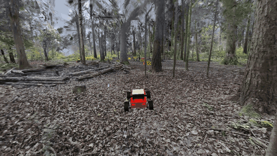
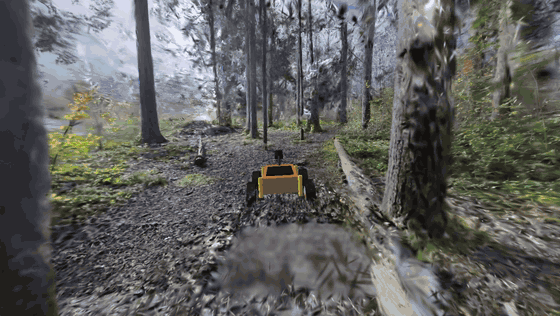
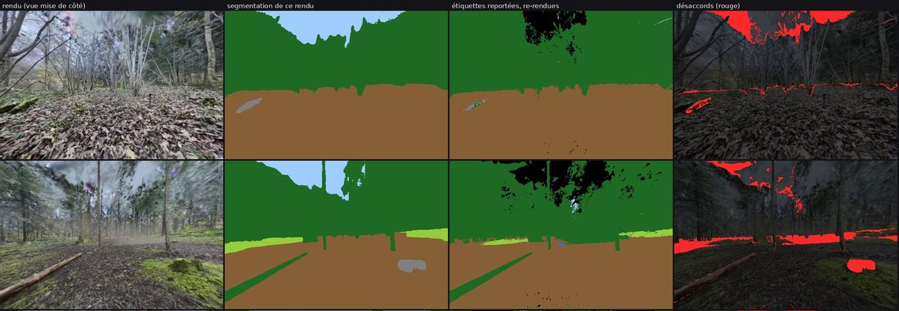
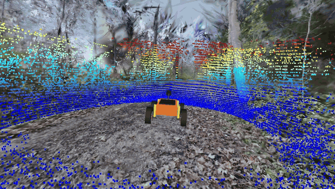
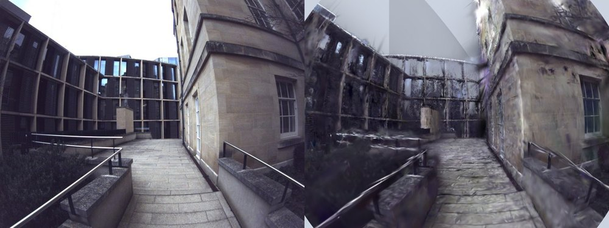

# SplatSim

Two connected pieces of work around Gaussian splatting and LiDAR:

- `splatpipe/`: an offline pipeline that builds a Gaussian splat from a backpack scan (LiDAR, three fisheye cameras, IMU) and checks its geometry against the LiDAR. Data: Oxford Spires.
- `simrobot/`: a small robot simulator inside a 200 m forest splat, with MuJoCo physics, a simulated LiDAR, semantic labels on the gaussians and a browser viewer. Data: GrandTour and GaussGym.



The race demo: a small rear-wheel-drive car on the path walked by the ANYmal robot that recorded the scene. The splat is streamed in the browser with PlayCanvas, the physics runs in MuJoCo on a Python server. The yellow chevrons mark the turns, the cones mark a gate every 10 m.

## simrobot

The scene is the HÖB-1 forest mission of the GrandTour dataset: 21 GaussGym tiles merged into one splat of 19.4 M gaussians covering about 205 m of trail, shown with streamed levels of detail.

| Part | How |
|---|---|
| Physics | MuJoCo, wheeled robot or car, on a 10 cm height field from the GrandTour LiDAR map. Trunks are capsules, inclined ones fitted from the labeled gaussians. |
| Simulated LiDAR | 32 x 1024 spinning scan cast through a 5 cm occupancy map, measured by replaying the 4,754 real Hesai scans. Each voxel has an extinction coefficient, so foliage lets part of the rays through. 16 to 22 ms per revolution with numba on CPU. |
| Semantic labels | 2,655 renders of the splat segmented with EoMT-DINOv3-L (ADE20K classes), then lifted back onto the gaussians. |
| Ground | Each wheel gets its friction and rolling resistance from the class of the ground under it. Bushes slow the robot down instead of blocking it, and the contact is on the ground under the vegetation, not on top of it. |
| Viewer | PlayCanvas, WebGPU or WebGL2. The server sends the robot state at 60 Hz over a WebSocket. |

### Semantic labels



Key E switches between the RGB splat and the splat colored by class: brown earth, dark green tree, light green plant, beige path.

Lifting works in one backward pass. Render the splat with one channel per class and a zero color for every gaussian, take the dot product with the per-pixel class scores of the segmenter, and backpropagate: the gradient on each gaussian's color is the sum over pixels of its blending weight times the class scores, which is exactly a weighted vote. A first one-channel pass keeps only the gaussians that contribute to the view (about 1.3 M out of up to 14 M in the frustum).



Check on views never used for lifting: render, segmentation of that render, lifted labels rendered back, disagreement in red. Over 264 held-out views, 92.7 % of the pixels agree. Most disagreements are sky seen through the canopy and class boundaries.

### Simulated LiDAR



Points colored by height. On 30 held-out Hesai scans (1.6 M rays), 45 % of the simulated ranges are within 10 cm of the measured ones, and the median range is 7.55 m simulated against 7.60 m measured.

The LiDAR map also contained the people who walked next to the robot during the recording. Voxels with no visible gaussian nearby, within 3 m of the path, are removed (805,000 voxels).

### Driving

- The wheeled robot follows the real ANYmal path on 30 of 32 segments without flipping over.
- The car: 18 kg, torque-controlled rear motors, handbrake, aero drag, Ackermann steering. MuJoCo friction is Coulomb friction, so a spinning wheel has no lateral grip left; without traction control the car spun out at full throttle in a straight line. With it, the car can hold a drift of about 20 degrees on loose ground with counter-steer.
- An autopilot (pure pursuit) completes the 250 m lap in 68 s at 8 m/s.

### Running

A prepared scene folder is needed (not in this repository, see below). The server runs on any machine with Python; only building a scene needs a CUDA GPU.

```bash
pip install -r requirements.txt
cd simrobot/viewer && npm install && cd ../..

# simulator, then open http://localhost:8765
python simrobot/sim/server.py --scene data_local/simrobot/scenes/HOB-1_full --port 8765

# race demo, then open http://localhost:8770
python simrobot/sim/server.py --scene data_local/simrobot/scenes/HOB-1_full --jeu --port 8770
```

Simulator controls:

| Key | Action |
|---|---|
| ZQSD, WASD or arrows | Drive |
| Space / Shift | Brake / turbo |
| C | Camera: chase, free orbit, sensor |
| E | Semantic splat |
| K | LiDAR: off, colored by height, colored by intensity |
| T | Physics overlay: terrain, obstacles, vegetation |
| V | Onboard camera inset |
| J | Recorded path and camera poses |
| N / R | Next start / reset |
| F | Put the robot back on its wheels |
| P / H | Pause / help |

Race controls: arrows or WASD to drive, Space for the handbrake, Shift for turbo, C for chase or hood camera, R to go back to the last gate, Enter to restart, M for the map. A gamepad also works.

### Building a scene

Each script starts with a docstring that gives the exact command. Roughly in this order:

1. `sim/prepare_scene.py`: downloads the GaussGym tiles of a mission from Hugging Face, merges them (Voronoi), removes the capture rig that was reconstructed along the path, writes `scene.ply`, `terrain.npz` and the start poses.
2. `tools/build_lod.sh`: levels of detail (streamed SOG) with `@playcanvas/splat-transform`.
3. `sim/lidar_occupancy.py`, then `sim/occupancy_clean.py`: occupancy map from the real scans, people removed.
4. `tools/splat_labels.py segment`, `lift`, `check`, `export`: semantic labels, then `build_lod.sh` again on the class-colored splat.
5. `sim/splat_mesh.py`: trunk capsules and ground points from the labeled gaussians.
6. `sim/terrain_labels.py`: obstacle types, vegetation drag, ground corrections.
7. `sim/export_trajets.py`: recorded path and camera poses for the viewer.

## splatpipe

The goal is a splat whose geometry, on the surfaces the LiDAR saw, is as good as the LiDAR map, so it can serve as a reference for a physical LiDAR simulator later. Data: Oxford Spires, sequence `2024-03-13-observatory-quarter-01` (Hesai QT64, three 1440 x 1080 fisheye cameras, IMU, and a terrestrial laser scan as ground truth).



Courtyard, camera 0: photo on the left, render of the full-scene splat on the right. Geometry is the priority and image quality is the weak part: 17 to 19 dB PSNR on this view, with streaks where the trajectory passes many times.

| Stage | Folder | What |
|---|---|---|
| 0 | `stage0/` | Rosbag ingestion, LiDAR beam model, calibration check by reprojection of the map into the photos (median 2.6 to 2.9 px, no correction needed) |
| 1 | `stage1/` | GLIM LiDAR-inertial SLAM, IMU spline trajectory, 5 cm voxel map, evaluation against the laser scan |
| 2 | `stage2/` | Dynamic point removal (DUFOMap), Mask2Former segmentation, superpoints, label lifting, DINOv2 features |
| 3 | `stage3/` | Camera poses from the trajectory |
| 4 | `stage4/`, `train/` | Training with gsplat on sliding windows, previews, PLY export |

Training (`train/full.py`) starts from one gaussian per voxel of the LiDAR map, with colors taken from the photos. Each window along the trajectory optimizes an image loss (L1 + SSIM, per-image exposure, sky and people masked) and LiDAR losses on scans rendered with gsplat (range, free space along the rays, flatness of rigid surfaces).

Results:

- Trajectory: 4.6 cm absolute error (benchmark protocol of the dataset).
- Map against the laser scan: accuracy 5.4 cm, completeness 16.0 cm, F-score 0.73 at 5 cm and 0.89 at 10 cm. The dataset paper reports 0.61 and 0.85 for VILENS.
- Splat, on LiDAR scans never used for training: 57 to 83 % of the rays within 10 cm depending on the window, median error 2.6 to 4.0 cm.

Most heavy jobs ran on a desktop with an RTX 2070 Super. Some ran on Modal (`splatpipe/modal_common.py`) or on a rented L40 (`scripts/thunder/`).

## Layout

```
splatpipe/          pipeline, one subpackage per stage
  common/           camera and LiDAR models, trajectory, geometry
  train/            gsplat trainer, previews, PLY export, evaluation
simrobot/
  sim/              server, robot and car, terrain, simulated LiDAR, race track
  tools/            labeling, levels of detail, benchmarks, tests
  viewer/           PlayCanvas pages (simulator and race)
scripts/            data transfer and cloud GPU setup
```

Code comments and command-line messages are in French.

## Data and credits

- [Oxford Spires](https://github.com/ori-drs/oxford_spires_dataset) (CC BY-NC-SA 4.0)
- [GrandTour](https://huggingface.co/datasets/leggedrobotics/grand_tour_dataset) and its GaussGym splats
- [gsplat](https://github.com/nerfstudio-project/gsplat), [MuJoCo](https://github.com/google-deepmind/mujoco), [PlayCanvas](https://github.com/playcanvas/engine), [EoMT](https://github.com/tue-mps/eomt), [GLIM](https://github.com/koide3/glim), [DUFOMap](https://github.com/KTH-RPL/dufomap)

The images and GIFs in `docs/` are renders of these datasets.

## License

Apache 2.0 for the code. The datasets keep their own licenses.
